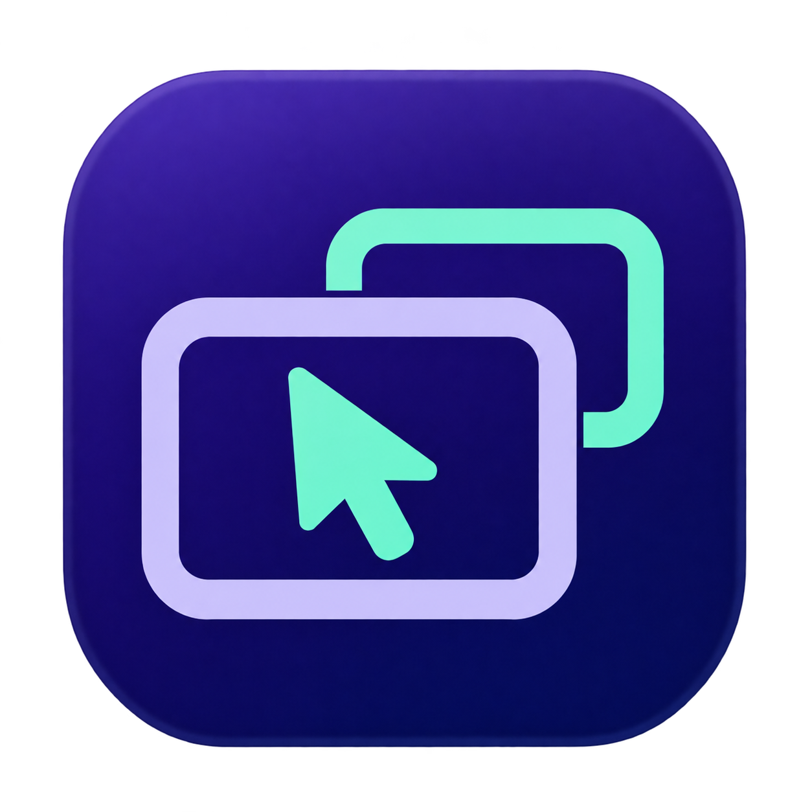
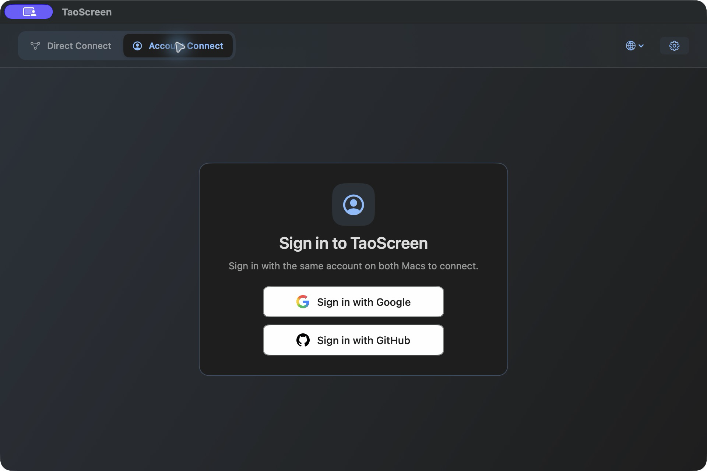

<div align="center">
  
  <h1>TaoScreen</h1>
  <p>Free, open-source remote desktop and network tunneling for macOS.</p>
  <p><a href="README.md">简体中文</a> · English</p>
  <p><a href="https://taoscreen.xujiangtao.com/download?lang=en">Download for macOS</a> · <a href="docs/user-guide.en.md">User Guide</a> · <a href="docs/deployment.en.md">Self-hosting Guide</a></p>
</div>

## Ways to connect

TaoScreen runs on macOS 14 or later on Apple silicon and Intel. The app opens to **Direct Connect**. Use the tabs at the top to switch connection modes.

| | Direct Connect | Account Connect |
| --- | --- | --- |
| Setup | Two Macs on the same LAN or Tailscale network | The official service or a self-hosted signaling server |
| Access | Six-character temporary password, or Tailscale unattended access with a fixed password or trusted device | Sign in on both Macs using the same TaoScreen account on the same server |
| Network | Bonjour on the LAN, or Tailscale IP and MagicDNS | Cross-network connectivity depends on the network and available relays |
| Main features | Screen sharing, keyboard and mouse control, and optional system audio. Confirmed sessions can also share the clipboard and transfer files. | Online device list, multiple remote tabs, unattended access, standalone TCP/UDP port forwarding, and optional lock on disconnect |

When the app follows the system language, it uses the first supported language in macOS preferences. Supported languages are English and Simplified Chinese. The globe menu lets you pick either language or return to the system setting. Confirm the app restart to apply the change.

## Quick start

1. Download the universal DMG, open it, and drag TaoScreen to **Applications**. See the [official download page](https://taoscreen.xujiangtao.com/download?lang=en).
2. On the Mac you want to share, use **Access Permissions** to grant **Screen & System Audio Recording** and, for control, **Accessibility**. See the [permissions guide](docs/user-guide.en.md#install-and-grant-permissions).
3. For temporary help, turn on **Allow Temporary Connections** in **Direct Connect**. Enter the host address and temporary password on the other Mac, then accept the request on the host.
4. For account-based connections, select **Account Connect** and sign in with Google or GitHub on both Macs. Turn on **Enable Remote Desktop** on both, then choose a device from the list. To use a self-hosted instance, sign out and open the gear menu to enter its HTTPS address under **Custom Server**.



## Features

- Native ScreenCaptureKit and WebRTC capture, with H.264 where available and VP8 support
- Five quality presets, up to 4K, and optional virtual extended displays at 1080p, 1440p, or 4K HiDPI
- Remote keyboard, mouse, system audio, local input methods, and dictation
- Privacy screen, clipboard sharing, file transfer and drag-and-drop
- Standalone bidirectional TCP/UDP port forwarding in account mode
- Device-based unattended access and optional remote login password storage in the local macOS Keychain
- A Go signaling server with PostgreSQL, Redis, Docker Compose, an admin console, and optional STUN/TURN configuration

The remote desktop transports media and data over encrypted WebRTC channels. Direct Connect authenticates temporary access with channel-bound PAKE and trusted devices with mutual TLS.

## Build from source

Install Xcode and XcodeGen, then run:

```sh
cd macos
./scripts/build-app.sh
open dist/TaoScreen.app
```

The official build defaults to the official account service. See the [macOS build guide](macos/README.en.md) for custom server and update settings.

## Documentation

| Document | What it covers |
| --- | --- |
| [User Guide](docs/user-guide.en.md) | LAN and Tailscale connections, permissions, account sign-in, and remote tools |
| [Self-hosting Guide](docs/deployment.en.md) | Docker Compose, HTTPS, accounts, relays, and updates |
| [macOS Client](macos/README.en.md) | Local builds, releases, code signing, and client features |
| [Server](server/README.en.md) | Configuration, endpoints, and testing |
| [Authentication](server/docs/authentication.en.md) | Email/password, Google, GitHub, admin access, and account linking |
| [Desktop Protocol](server/docs/remote-desktop.en.md) | Desktop and port forwarding signaling |
| [Desktop Downloads and Updates](server/docs/desktop-updates.en.md) | Release manifests, DMGs, and Sparkle |
| [Security](SECURITY.en.md) | How to report a vulnerability privately |

Mobile and Windows clients are on the roadmap.

## License

TaoScreen is licensed under [Apache-2.0](LICENSE). See the [third-party notices](THIRD_PARTY_NOTICES.en.md) for dependency licenses.
