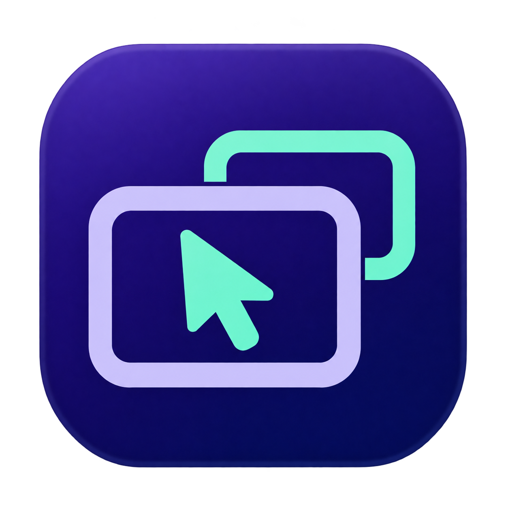
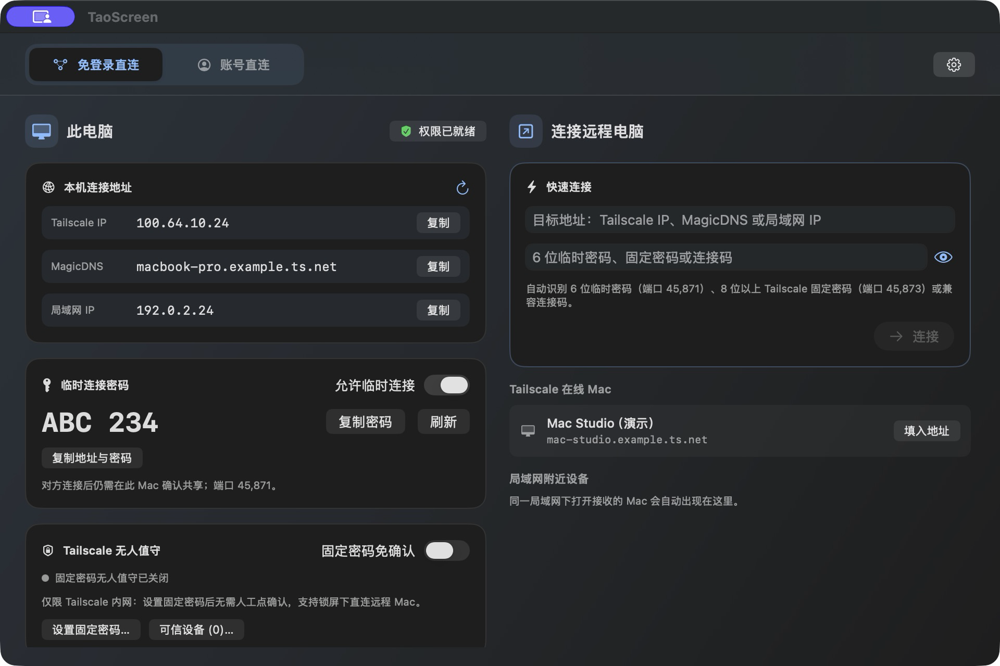
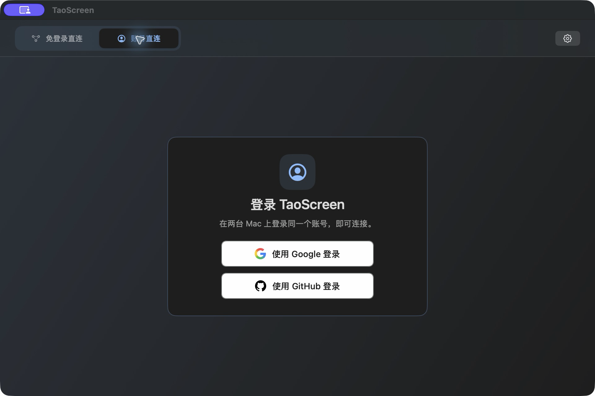
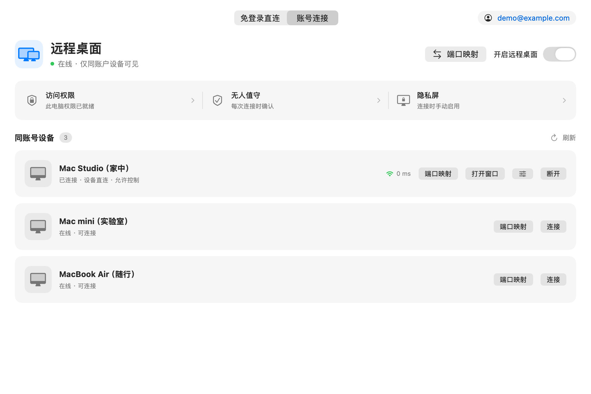
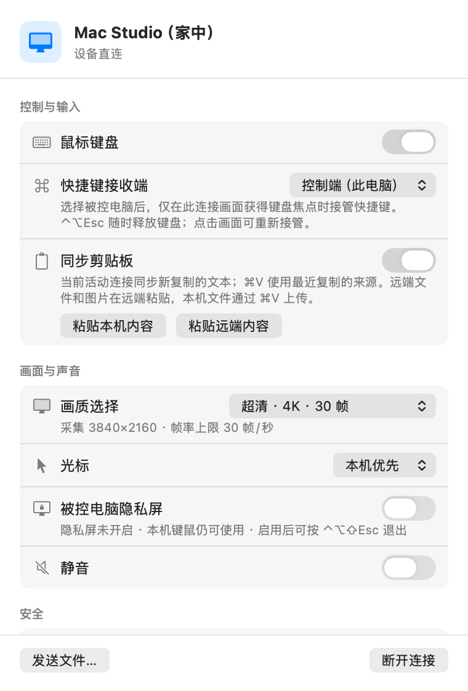
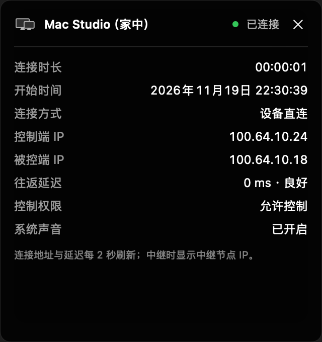
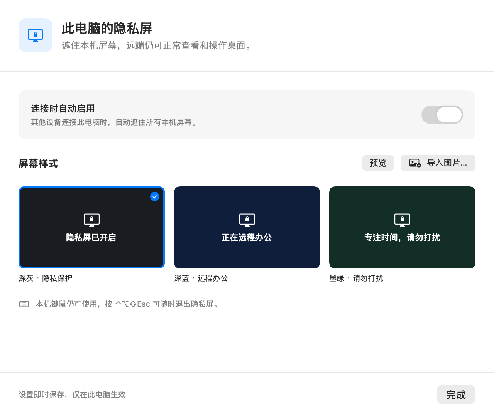
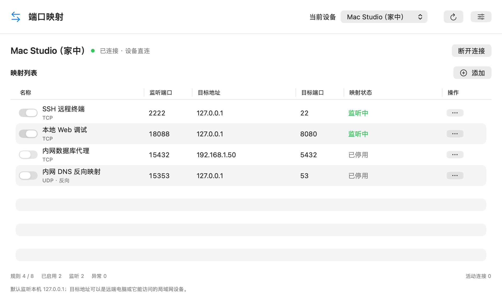
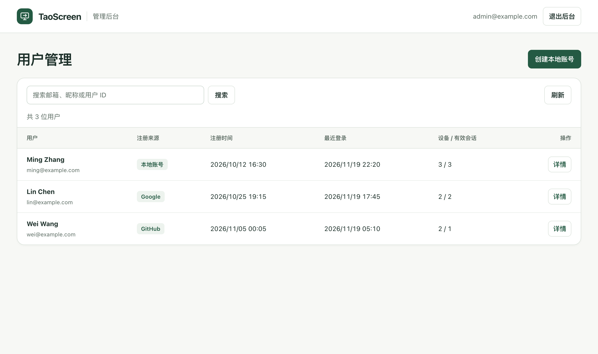
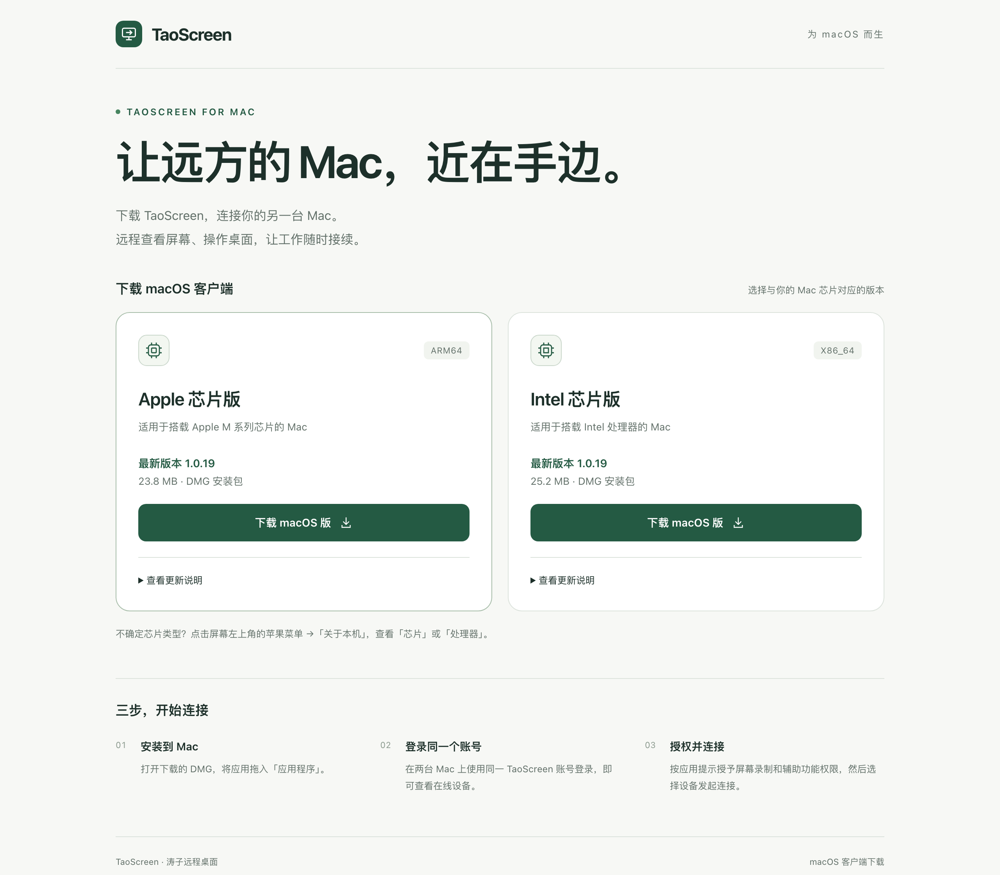

<div align="center">
  
  <h1>TaoScreen 涛子远程桌面</h1>
  <p>简体中文 · <a href="README.en.md">English</a></p>
  <p><strong>轻量、安全、可控的开源远程桌面与内网通道工具</strong></p>
  <p>支持 <strong>Tailscale / 局域网免登录直连</strong>，也支持通过 <strong>官方服务或自托管信令服务器</strong> 连接同账号设备</p>
  <p>
    <a href="LICENSE"></a>
    
    
    
  </p>
  <p>
    <a href="https://taoscreen.xujiangtao.com/download">官网下载</a> ·
    <a href="#两种使用方式">使用方式</a> ·
    <a href="#界面预览">界面预览</a> ·
    <a href="#当前已实现功能">功能清单</a> ·
    <a href="docs/user-guide.md">详细使用指南</a> ·
    <a href="docs/deployment.md">自托管部署指南</a> ·
    <a href="#后续规划-roadmap">后续规划</a>
  </p>
</div>

---

**TaoScreen（涛子远程桌面）** 是一款专注于原生体验与数据自主可控的远程桌面项目。当前已完整实现 **macOS 14+ 原生桌面端**（Apple Silicon / Intel）与 **Go 自托管账号信令服务端**，后续规划覆盖 **iOS / Android 手机端** 与 **Windows 平台**。

客户端启动后默认打开 **「免登录直连」**，可以通过 **Tailscale** 或局域网连接。切换到 **「账号直连」** 后，可使用官方服务或自己的信令服务管理同账号设备。

客户端默认跟随 macOS 的首选语言，支持简体中文和 English。通过右上角的地球图标可以手动选择，确认重启应用后生效。

## 核心特点

- **零服务端门槛，纯客户端即可直连**：内置「免登录直连」模式，无需搭建服务端或注册账号。两台 Mac 处于同一局域网，或连通 **Tailscale** 虚拟内网后即可直接建立点对点加密桌面会话，支持 6 位临时密码、Tailscale 固定密码无人值守与可信设备配对免密。
- **可控自托管信令，同账号集中管理**：提供基于 Go + PostgreSQL + Redis 的轻量化服务端（Docker Compose 一键拉起）。同一账号下的所有在线设备自动列于一处，支持多标签并发控制、独立双向端口映射、账号管理后台及可选 TURN 中继。
- **原生高画质低延迟体验**：基于 Apple `ScreenCaptureKit` 与原生 `WebRTC`（H.264 硬件编解码 / VP8 回落），支持 **4K / 60fps 五档画质实时无感切换**、`1080p / 1440p / 4K HiDPI` 虚拟扩展屏、本机输入法与语音听写、系统声音传输及文件拖拽投放。
- **端到端加密与隐私优先**：媒体、键鼠、文件和端口数据均走 WebRTC DTLS-SRTP 加密通道；免登录直连采用 **通道绑定 PAKE（Curve25519 Elligator2）** 与 **双向 TLS 公钥认证**；服务端不保存画面、输入、密码或文件，本地密码受 macOS 钥匙串与 Touch ID 硬件保护。

---

## 两种使用方式

两种连接方式可在客户端顶部切换。

| 对比维度 | 免登录直连 | 账号直连 |
| --- | --- | --- |
| **服务端** | 无需服务端 | 官网版默认使用官方服务，也可通过 Docker Compose 自托管 |
| **适用网络** | 同一局域网（Bonjour 自动发现）或 **Tailscale 内网** | 支持跨网络连接，能否建立会话取决于两端网络和可用中继 |
| **身份与连接方式** | • **6 位临时密码**（TCP `45871`，逐次确认）<br>• **Tailscale 固定密码**（TCP `45873`，免确认）<br>• **Tailscale 可信设备**（TCP `45872`，密钥对免密） | 官方登录支持 Google 和 GitHub。自托管实例可启用邮箱密码、Google 或 GitHub。登录后从同账号在线设备列表发起连接 |
| **无人值守（含锁屏直连）** | 支持（Tailscale 固定密码或已配对可信设备，仅限 Tailnet） | 支持（按账号与设备配置的同账号无人值守） |
| **核心能力** | 屏幕共享（含虚拟屏）、键鼠控制、系统声音；逐次确认直连另支持文件传输与剪贴板同步 | 同账号设备列表、多标签控制、**独立双向 TCP/UDP 端口映射**、**本机钥匙串 Touch ID 一键解锁**、**断连自动锁屏** |

> 详细操作步骤与端口说明请参阅 [TaoScreen 使用指南](docs/user-guide.md)。

---

## 界面预览

以下直连、登录和设备列表截图来自 macOS 1.0.23 界面，使用演示数据。

### 1. 免登录直连与 Tailscale 无人值守（仅客户端）

自动探测本机 Tailscale IP / MagicDNS / 局域网 IP 与在线 Tailscale Mac 节点，支持 6 位临时密码逐次确认，以及 Tailscale 固定密码与可信设备无人值守。



### 2. 账号登录与同账号设备列表

在「账号直连」中使用 Google 或 GitHub 登录。右上角齿轮可切换到自定义服务器。



登录后可查看同账号在线 Mac，并从设备列表发起连接或打开端口映射。



### 3. 连接设置、五档画质切换与链路状态浮窗

会话中可随时切换五档画质、本机/远端输入法（支持语音听写）、快捷键接收端与光标模式；悬停信号图标可查看控制端/被控端真实连接 IPv4/IPv6 与实时 RTT。

<table>
  <tr>
    <td align="center" width="54%">
      
      <br><sub>连接设置与五档画质实时切换</sub>
    </td>
    <td align="center" width="46%">
      
      <br><sub>链路状态浮窗（IP / 延迟 / 权限）</sub>
    </td>
  </tr>
</table>

### 4. 隐私屏与独立双向 TCP / UDP 端口映射

支持连接自动启用或实时切换多款隐私屏遮住被控实体屏幕；独立端口映射基于专用 WebRTC 数据通道，无需先打开桌面画面即可进行正向/反向 TCP/UDP 转发。

<table>
  <tr>
    <td align="center" width="44%">
      
      <br><sub>隐私屏设置（支持自定义图片与 ⌃⌥⇧Esc 紧急退出）</sub>
    </td>
    <td align="center" width="56%">
      
      <br><sub>独立双向 TCP / UDP 端口映射管理</sub>
    </td>
  </tr>
</table>

### 5. 自托管管理后台与客户端下载页

服务端自带独立的本地管理员后台（`/admin`，支持 TOTP 动态码与 Cloudflare Access）及公开客户端下载页（`/download`，展示 Apple Silicon / Intel 版本与更新说明）。

<table>
  <tr>
    <td align="center" width="50%">
      
      <br><sub>服务端管理后台（/admin）</sub>
    </td>
    <td align="center" width="50%">
      
      <br><sub>自托管下载页（/download）</sub>
    </td>
  </tr>
</table>

---

## 当前已实现功能

<details open>
<summary><strong>点击展开 / 收起已落地功能模块明细（macOS 客户端 + Go 服务端）</strong></summary>

- **多样化连接与认证**：
  - 局域网 Bonjour 自动发现 + 6 位临时密码直连（通道绑定 PAKE，5 次错锁 60 秒）
  - Tailscale 节点自动识别（支持官网/Homebrew CLI 及 Mac App Store 版 `utun` 回落）、Tailscale 固定密码无人值守（PBKDF2 钥匙串校验）与可信设备双向 TLS 免密
  - 账号模式支持邮箱密码、Google / GitHub PKCE OAuth 登录及主动账号绑定、同账号无人值守、WebSocket 心跳租约与 60 秒断线无缝恢复
- **屏幕、画质与音频**：
  - 五档画质实时无感切换：`节省流量 (720p/15fps)`、`标准 (1080p/30fps)`、`流畅优先 (1080p/60fps)`、`高清 (1440p/30fps)`、`超清默认 (4K/30fps)`，按设备记忆偏好
  - 按连接创建 `1920×1080`、`2560×1440`、`3840×2160 (HiDPI)` 60 Hz **虚拟扩展屏**，结束自动移除
  - 系统音频实时采集与静音控制
- **键鼠、输入法与 macOS 快捷操作**：
  - 远端输入法 / 本机输入法（支持语音听写与底部预编辑字幕）自由切换
  - 快捷键接收端切换（`⌃⌥Esc` 随时释放焦点），顶部快捷按钮（调度中心 `⌃↑`、显示 Dock `⌃F3`、当前应用窗口 `⌃↓`、显示桌面 `F11`、切换全屏 `⌃⌘F`、Esc）
  - 本机优先 / 远端原样双光标模式
- **剪贴板与文件传输**：
  - 双向文本剪贴板同步、`⌘V` 智能粘贴与本地文件一键上传
  - 拖拽文件/文件夹至远程窗口指定位置投放（暂存 7 天并支持路径复制），或发送至 `下载/TaoScreen`；独立可靠通道 + SHA-256 校验
- **安全与隐私保护**：
  - **隐私屏**：3 款预设 + 最多 20 张自定义图片，支持连接自动启用与 `⌃⌥⇧Esc` 紧急退出
  - **远程登录密码与断连锁屏**：控制端钥匙串保存远程 Mac 密码，通过 Touch ID / 本机密码验证后解锁（不经服务器与剪贴板）；支持断连或异常失联后自动发送 `⌃⌘Q` 锁屏
- **独立双向 TCP / UDP 端口映射**：
  - 独立 WebRTC `desktop-ports.v1` 数据通道，无需开启桌面画面，支持正向/反向映射、本机 `127.0.0.1` 或局域网 `0.0.0.0` 监听、单条启停、创建副本、离线规则编辑与重连自动恢复
- **服务端运维与分发**：
  - Docker Compose 编排（API / PostgreSQL 18 / Redis 7.4 / 自动迁移）、本地 TOTP 管理员后台、Cloudflare Access 支持、coturn TURN 短期凭据签发、Sparkle 2.10 Ed25519 应用内自动更新与 `/download` 分发页

</details>

---

## 快速开始

从 [官网下载](https://taoscreen.xujiangtao.com/download) DMG，打开后将 TaoScreen 拖入「应用程序」。

### 从源码构建（可选）

安装 Xcode、Swift 工具链与 XcodeGen（`brew install xcodegen`），然后运行以下命令。

```sh
cd macos
./scripts/build-app.sh
open dist/TaoScreen.app
```

> 首次在被控端共享屏幕或接受控制时，请按应用引导在「系统设置 → 隐私与安全性」授予 **录屏与系统录音** 与 **辅助功能** 权限（详见 [首次权限配置](docs/user-guide.md#1-安装与首次权限配置)）。

### 方案 A：仅客户端配合 Tailscale / 局域网直连（无需部署服务端）

1. 在两台 Mac 上启动 `TaoScreen.app`，保持在顶部的 **「免登录直连」** 标签页（若使用跨网互联，请先连通两端 Tailscale）。
2. **临时协助**：在被控 Mac 开启 **「允许临时连接」**，控制端从「Tailscale 在线 Mac」或「局域网附近设备」选择目标（或输入对方 Tailscale IP / MagicDNS / 局域网 IP）并填入 6 位临时密码，被控端点击「接受并共享」即可。
3. **长期无人值守**：在被控 Mac 的「Tailscale 无人值守」卡片中点击「设置固定密码…」，设置 8 位以上密码后开启「固定密码免确认」。也可打开「可信设备」配对并授予无人值守权限。保持被控 Mac 登录且在线时，可通过 Tailscale 在锁屏下直连。

### 方案 B：使用官方服务账号直连

1. 在两台 Mac 上打开官网版 TaoScreen，切换到 **「账号直连」**。
2. 使用同一个 Google 或 GitHub 账号登录，并在两台 Mac 上开启 **「开启远程桌面」**。
3. 在控制端，从 **「同账号设备」** 列表选择目标 Mac，点击 **「连接」**。

### 方案 C：使用自托管信令服务器

本地测试需要 Docker Compose v2 与 Python 3。

```sh
cd server
python3 scripts/setup-local.py
docker compose up -d --build --wait
docker compose exec api /server create-user user@example.com
```

在启动服务的 Mac 上，打开 **「账号直连」**，点击右上角齿轮，在 **「自定义服务器」** 中填入 `http://127.0.0.1:28080` 并保存。等客户端检查完登录方式后，再打开齿轮，选择 **「使用邮箱和密码登录」**。其他 Mac 使用可访问的实例 HTTPS 地址。

> 生产环境自托管（HTTPS 反向代理、管理员后台、OAuth、coturn TURN 中继及更新分发）请阅读完整的 **[自托管部署指南](docs/deployment.md)**。

---

## 后续规划（Roadmap）

TaoScreen 计划开源后持续向全平台远程互联演进，当前主要规划如下：

- [x] **macOS 客户端（Apple Silicon / Intel）与 Go 自托管服务端**：完成免登录直连（局域网 / Tailscale）、同账号控制、4K/60fps 实时画质切换、虚拟扩展屏、隐私屏、文件传输、安全解锁与独立双向端口映射。
- [ ] **移动端支持（iOS / iPadOS 与 Android）**：开发原生 iOS 与 Android 客户端，支持随时随地通过手机或平板查看与操控 Mac / Windows 桌面（适配触控手势、虚拟鼠标与移动端快捷键盘）。
- [ ] **Windows 平台支持**：推出 Windows 原生客户端，同时支持作为控制端与被控端，打通 macOS、Windows 与移动设备之间的跨平台远程桌面与端口映射互联。
- [ ] **开源发行与社区生态完善**：补充 CI 自动构建与预编译 Release 产物分发、完善多语言文档、开放贡献指南与 Issue / PR 模板。

---

## 仓库结构与文档索引

| 目录 / 文档 | 说明 |
| --- | --- |
| [macos/](macos/README.md) | macOS 客户端源码（SwiftUI + 原生 WebRTC + Sparkle）、构建脚本与单元测试 |
| [server/](server/README.md) | Go 账号、设备会话与信令服务源码、Docker Compose 编排与集成测试 |
| [docs/user-guide.md](docs/user-guide.md) | 完整用户操作手册（免登录直连、Tailscale 无人值守、账号模式与进阶功能） |
| [docs/deployment.md](docs/deployment.md) | 自托管生产部署指南（Docker Compose、Caddy/Nginx、管理员后台、coturn 中继） |
| [server/docs/authentication.md](server/docs/authentication.md) | 本地管理员、TOTP 动态码、Google/GitHub PKCE OAuth 与 Cloudflare Access 详细说明 |
| [server/docs/remote-desktop.md](server/docs/remote-desktop.md) | 独立桌面与端口转发信令协议规范 |
| [server/docs/desktop-updates.md](server/docs/desktop-updates.md) | 桌面安装包发布清单与更新机制说明 |
| [SECURITY.md](SECURITY.md) | 安全漏洞私密报告指引 |
| [THIRD_PARTY_NOTICES.md](THIRD_PARTY_NOTICES.md) | 第三方组件与许可证声明 |

## 许可证

TaoScreen 源码采用 [Apache-2.0](LICENSE) 开源许可证。外部依赖及其许可条款见 [THIRD_PARTY_NOTICES.md](THIRD_PARTY_NOTICES.md)。
