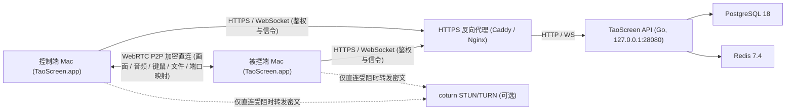
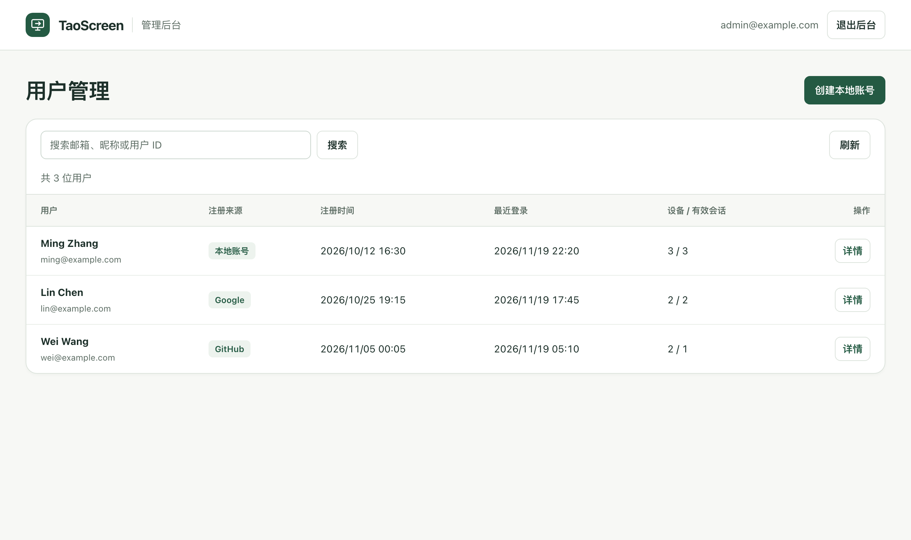
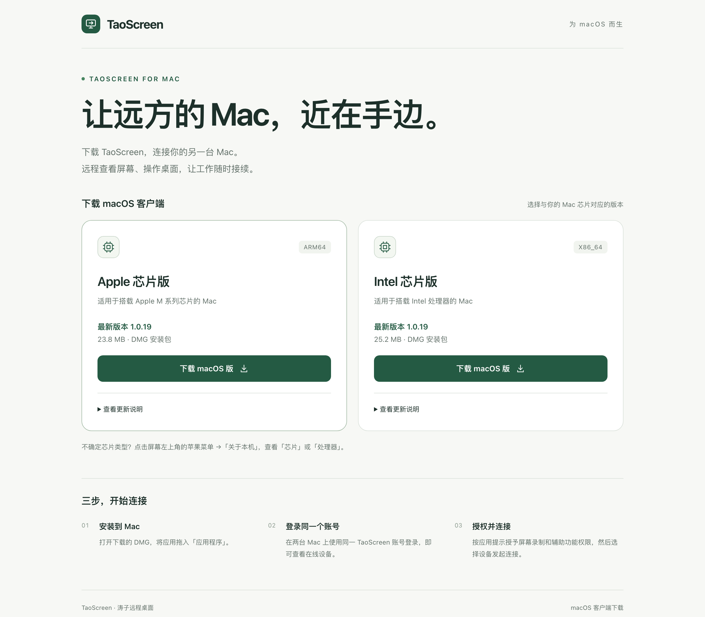

# TaoScreen 自托管部署指南

[返回项目首页](../README.md) · [使用指南](user-guide.md) · [服务端技术说明](../server/README.md) · [登录与后台配置](../server/docs/authentication.md) · [独立桌面协议](../server/docs/remote-desktop.md)

如果你只在局域网或 Tailscale 内网使用 TaoScreen，**无需部署任何服务端**，直接在两台 Mac 上使用客户端的「免登录直连」即可（详见 [使用指南](user-guide.md#2-使用方式一只客户端免登录直连局域网--tailscale)）。

如果你希望跨公网通过统一账号管理名下所有在线 Mac、开启同账号无人值守、使用独立双向 TCP/UDP 端口映射，或为无法直连的对称 NAT 网络配置 TURN 中继，可以使用仓库中自带的 Go 信令服务（`server/`）自行部署。

---

## 目录

- [1. 架构概览](#1-架构概览)
- [2. 环境要求与端口清单](#2-环境要求与端口清单)
- [3. 本地快速体验（开发环境）](#3-本地快速体验开发环境)
- [4. 生产环境自托管部署（Docker Compose + HTTPS）](#4-生产环境自托管部署docker-compose--https)
  - [4.1 准备环境变量](#41-准备环境变量)
  - [4.2 配置 HTTPS 反向代理](#42-配置-https-反向代理)
  - [4.3 启动容器与执行数据库迁移](#43-启动容器与执行数据库迁移)
  - [4.4 初始化管理员与用户账号](#44-初始化管理员与用户账号)
- [5. 可选进阶配置](#5-可选进阶配置)
  - [5.1 Google / GitHub 第三方登录](#51-google--github-第三方登录)
  - [5.2 Cloudflare Access 管理后台](#52-cloudflare-access-管理后台)
  - [5.3 跨网 TURN 中继服务器（coturn）](#53-跨网-turn-中继服务器coturn)
  - [5.4 客户端下载页 `/download` 与 Sparkle 自动更新](#54-客户端下载页-download-与-sparkle-自动更新)
- [6. 备份、升级与运维注意事项](#6-备份升级与运维注意事项)

---

## 1. 架构概览



- **数据边界**：服务端仅处理账号认证、设备会话、在线列表和短期信令中转（基于 Redis Pub/Sub），**不保存或经手桌面视频流、音频、键鼠输入、文件传输内容、端口映射业务载荷或远端 Mac 登录密码**。
- **独立运行**：`server/compose.yaml` 自带独立的 PostgreSQL（`postgres:18.3-alpine`）、Redis（`redis:7.4-alpine`）、一次性迁移任务（`migrate`）和以只读根文件系统、最小权限运行的 `api` 服务。

---

## 2. 环境要求与端口清单

### 软件依赖

- **Docker Engine** 与 **Docker Compose v2**
- **Python 3**（仅本地初始化脚本 `setup-local.py` 与集成测试需要）
- **HTTPS 反向代理**（生产环境必备，如 Caddy、Nginx 或 Traefik；客户端远程连接强制要求 HTTPS）

### 端口清单

| 场景 | 端口与协议 | 监听范围 / 用途 |
| --- | --- | --- |
| **自托管服务端（宿主机）** | `127.0.0.1:28080` (TCP) | Compose 发布的 Go API 回环端口，由反向代理通过 HTTPS `443` 对外暴露 |
| **客户端免登录直连** | `45871` (TCP) | 临时密码 / 兼容连接码直连信令（局域网 / Tailscale） |
| **Tailscale 可信设备无人值守** | `45872` (TCP) | 仅绑定被控 Mac 的 Tailscale 地址（双向 TLS 验证已配对设备公钥） |
| **Tailscale 固定密码无人值守** | `45873` (TCP) | 仅绑定被控 Mac 的 Tailscale 地址（通道绑定 PAKE 固定密码验证） |
| **WebRTC 媒体直连** | 动态 UDP 端口 | 客户端之间 P2P 传输音视频与数据通道 |
| **可选 coturn 中继** | `3478` (TCP/UDP)、`5349` (TLS)、`49160–49260` (UDP) | 公网对称 NAT 等跨网环境下的密文中继 |

---

## 3. 本地快速体验（开发环境）

在仓库根目录执行以下命令可在本地回环地址 `http://127.0.0.1:28080` 拉起完整开发实例（允许 HTTP 本地连接与密码注册）：

```sh
cd server
python3 scripts/setup-local.py
docker compose up -d --build --wait
curl http://127.0.0.1:28080/health/ready
```

预期返回：`{"service":"taoscreen","status":"ready"}`。

创建测试账号后即可用客户端测试登录：

```sh
docker compose exec api /server create-user user@example.com
```

在运行服务的 Mac 上打开客户端，切换到 **「账号直连」**，点击右上角齿轮，在 **「自定义服务器」** 中填入 `http://127.0.0.1:28080` 并点击 **「保存」**。等登录方式检测完成后，再打开右上角齿轮，选择 **「使用邮箱和密码登录」**，输入刚创建的账号。

开发验证命令（在 `server/` 目录下执行）：

```sh
make test         # Go 单元测试
make check        # go vet 静态检查
make auth-test    # OAuth / 管理后台真实数据库与 Redis 协议测试
make integration  # 完整端到端集成测试（指向 127.0.0.1:28080，含约 85 秒租约回收检查）
```

停止本地服务（保留数据库卷）：`docker compose down`。

---

## 4. 生产环境自托管部署（Docker Compose + HTTPS）

### 4.1 准备环境变量

在 `server/` 目录复制生产模板为仅部署者可读的 `.env.selfhost`（`.gitignore` 已自动忽略 `.env*` 文件）：

```sh
cd server
cp .env.production.example .env.selfhost
chmod 600 .env.selfhost
```

编辑 `.env.selfhost`：

- 生成强数据库密码填入 `POSTGRES_PASSWORD`。
- 设置 `AUTH_PUBLIC_URL` 为你的实例公网 HTTPS 根地址（例如 `https://desktop.example.com`，不带尾部斜杠与路径）。
- 默认 `ADMIN_TOTP_ENABLED=true`，使用 `openssl rand -base64 32` 生成 `ADMIN_TOTP_KEY`（需与数据库备份一同妥善保管）；如果不需要管理员动态验证码，可将 `ADMIN_TOTP_ENABLED=false` 并留空 `ADMIN_TOTP_KEY`。

核心环境变量说明：

| 变量名 | 示例 / 默认值 | 说明 |
| --- | --- | --- |
| `APP_ENV` | `production` | 运行环境：`development`、`test` 或 `production` |
| `POSTGRES_PASSWORD` | 随机高强度字符串 | Compose 内部 PostgreSQL 数据库密码，不可使用占位符 |
| `ALLOW_REGISTRATION` | `false` | 是否开放 HTTP 自助注册（**生产环境强制要求 `false`**） |
| `ALLOW_PASSWORD_LOGIN` | `true` | 是否允许普通用户使用邮箱与密码登录 |
| `ALLOW_SOCIAL_SIGNUP` | `false` | 首次 Google / GitHub 登录时是否自动创建新账号 |
| `AUTH_PUBLIC_URL` | `https://desktop.example.com` | 实例对外 HTTPS 根地址（启用本地后台会话 Cookie 或 OAuth 时必填） |
| `DESKTOP_OAUTH_CALLBACK_SCHEME` | `taoscreen` | 浏览器完成 OAuth 授权后跳回桌面客户端的 URL Scheme |
| `ADMIN_AUTH_MODE` | `local` | 后台鉴权模式：`local`（本地后台）、`cloudflare_access` 或 `disabled` |
| `ADMIN_TOTP_ENABLED` | `true` | 本地管理员是否启用 TOTP 动态验证码（设 `false` 则仅用密码） |
| `ADMIN_TOTP_KEY` | Base64 32 字节密钥 | 开启动态码时用于加密存储 TOTP 种子的密钥 |
| `TRUSTED_PROXY_CIDRS` | 如 `172.18.0.1/32` | 受信任的直接反向代理 IP/CIDR（多个用逗号分隔，不接受 `0.0.0.0/0`） |
| `CLOUDFLARE_PROXY_CIDRS` | 空 | 如前端接入 Cloudflare CDN/Tunnel，填写其回源网段 |
| `DESKTOP_STUN_URLS` | 如 `stun:turn.example.com:3478` | 逗号分隔 STUN 地址（留空仅尝试内网/Tailscale/本地直连候选） |
| `DESKTOP_TURN_URLS` | 如 `turn:turn.example.com:3478,turns:turn.example.com:5349?transport=tcp` | 逗号分隔 TURN 地址（与 `DESKTOP_TURN_SECRET` 成对配置） |
| `DESKTOP_TURN_SECRET` | ≥ 32 字节随机密钥 | 与 coturn 共享的 REST 鉴权密钥 |
| `DESKTOP_RELEASE_ORIGIN` | 如 `https://downloads.example.com` | 可选，配置后 `/download` 页面展示桌面端最新 DMG 下载 |

### 4.2 配置 HTTPS 反向代理

Compose 默认将 API 绑定在宿主机回环 **`127.0.0.1:28080`**，因此需要通过反向代理提供 TLS（HTTPS）并正确转发 WebSocket 与代理头：

- **必须保留原始 `Host` 头**；
- **必须覆盖客户端传入的 `X-Forwarded-Proto`** 为代理实际接收协议（`https`）；
- **必须转发 WebSocket**（`/v1/desktop/signal`、`/v1/ports/signal`），并配置足够长的读写超时（客户端每 25 秒发送心跳维持长连接）；
- 将 API 容器实际看到的直接代理 IP（宿主机上运行的代理经 Docker 桥接转发时，通常是对应 Docker 网络的网关地址，如 `172.18.0.1/32`）写入 `TRUSTED_PROXY_CIDRS`。

**Caddy 示例（自动申请 TLS 证书并原生支持 WebSocket）：**

```caddyfile
desktop.example.com {
    reverse_proxy 127.0.0.1:28080
}
```

**Nginx 示例：**

```nginx
map $http_upgrade $connection_upgrade {
    default upgrade;
    ''      close;
}

server {
    listen 443 ssl http2;
    server_name desktop.example.com;

    ssl_certificate     /etc/ssl/certs/desktop.example.com.pem;
    ssl_certificate_key /etc/ssl/private/desktop.example.com.key;

    location / {
        proxy_pass http://127.0.0.1:28080;
        proxy_http_version 1.1;
        proxy_set_header Host $host;
        proxy_set_header X-Real-IP $remote_addr;
        proxy_set_header X-Forwarded-For $proxy_add_x_forwarded_for;
        proxy_set_header X-Forwarded-Proto $scheme;
        proxy_set_header Upgrade $http_upgrade;
        proxy_set_header Connection $connection_upgrade;
        proxy_read_timeout 3600s;
        proxy_send_timeout 3600s;
    }
}
```

### 4.3 启动容器与执行数据库迁移

```sh
cd server
docker compose --env-file .env.selfhost up -d --build --wait
```

Compose 会先等待 PostgreSQL 与 Redis 健康就绪，再自动运行 `migrate` 容器执行数据库迁移，最后启动并健康检查 `api` 服务。

### 4.4 初始化管理员与用户账号

1. **创建本地管理员**：
   ```sh
   docker compose --env-file .env.selfhost exec api /server create-admin admin@example.com
   ```
   按提示输入管理员密码。当 `ADMIN_TOTP_ENABLED=true` 时，终端会输出验证器二维码/密钥并要求输入 6 位动态码，随后生成一次性恢复码（请离线妥善保存）。

2. **登录管理后台创建用户**：
   在浏览器访问 `https://desktop.example.com/admin`（或根路径 `/`）登录后，即可搜索用户、查看设备/有效会话统计、点击 **「创建本地账号」** 开通普通用户：

   

3. **命令行创建用户或重置管理员**：
   ```sh
   # 通过交互式 CLI 创建普通账号（密码至少 12 个字符）
   docker compose --env-file .env.selfhost exec api /server create-user user@example.com

   # 重置管理员密码并重新绑定验证器 / 替换恢复码
   docker compose --env-file .env.selfhost exec api /server reset-admin admin@example.com
   ```

4. 在两台 Mac 上切换到 **「账号直连」**，在右上角齿轮的 **「自定义服务器」** 中填写实例 HTTPS 地址（例如 `https://desktop.example.com`）并保存。等登录方式检测完成后，再打开齿轮，选择 **「使用邮箱和密码登录」**。两台 Mac 登录同一个普通账号，并打开 **「开启远程桌面」**。

---

## 5. 可选进阶配置

### 5.1 Google / GitHub 第三方登录

生产实例可启用 Google 和 GitHub OAuth 登录，客户端通过 `ASWebAuthenticationSession` 与 S256 PKCE 完成授权并在账号菜单中主动绑定多个身份到同一 TaoScreen 用户。详细申请步骤、回调 URI（`/v1/auth/oauth/{provider}/callback`）与验证流程见 [登录与管理员后台说明](../server/docs/authentication.md)。

### 5.2 Cloudflare Access 管理后台

如需由 Cloudflare Access 接管后台管理员鉴权，可将 `ADMIN_AUTH_MODE` 设为 `cloudflare_access`，并配置 `ADMIN_ACCESS_TEAM_DOMAIN`、`ADMIN_ACCESS_AUD` 与 `ADMIN_ALLOWED_EMAILS`。详见 [Cloudflare Access 配置](../server/docs/authentication.md#cloudflare-access可选)。

### 5.3 跨网 TURN 中继服务器（coturn）

在局域网、Tailscale 或普通锥形 NAT 网络环境下，WebRTC 可直接 P2P 打洞成功；若两端均位于严格企业防火墙或对称 NAT 后无法直连，建议部署独立的 `coturn` 实例：

1. 参考仓库自带模板 [`server/turnserver.conf.example`](../server/turnserver.conf.example) 配置 coturn，确保服务器放行 **3478 (TCP/UDP)**、**5349 (TLS)** 以及 **49160–49260 (UDP)** 中继端口（**不能**通过普通 HTTP 反向代理转发 TURN 流量）。
2. 将 coturn 的 `static-auth-secret` 与 `.env.selfhost` 中的 `DESKTOP_TURN_SECRET` 设为同一个 ≥ 32 字节的新随机密钥。
3. 在 `.env.selfhost` 中填写 `DESKTOP_STUN_URLS` 与 `DESKTOP_TURN_URLS` 并重启服务端生效（客户端通过 `/v1/desktop/config` 与 `/v1/ports/config` 获取短期 2 小时有效的 TURN 凭据）。

### 5.4 客户端下载页 `/download` 与 Sparkle 自动更新

服务内置公开下载页 **`/download`**。将打包并公证后的版本清单（`taoscreen-macos-arm64.json`、`taoscreen-macos-x86_64.json`）与 DMG 安装包托管到对象存储或静态 HTTPS 服务后，在 `.env.selfhost` 配置 `DESKTOP_RELEASE_ORIGIN` 即可激活下载页：



打包脚本、版本清单格式与 Sparkle 2.10 Ed25519 更新源配置见 [桌面下载与更新](../server/docs/desktop-updates.md) 与 [macOS 构建与发布](../macos/README.md#应用更新)。

---

## 6. 备份、升级与运维注意事项

- **停止与更新服务**：升级镜像或修改 `.env.selfhost` 后，重新执行 `docker compose --env-file .env.selfhost up -d --build --wait`；需要暂停服务时执行 `docker compose --env-file .env.selfhost down`。**切勿误执行 `down -v`**，否则会永久删除 PostgreSQL 数据卷。
- **备份策略**：定期使用 `pg_dump` 备份 PostgreSQL `taoscreen` 数据库；若启用了管理员动态验证码（`ADMIN_TOTP_ENABLED=true`），需将 `.env.selfhost` 中的 `ADMIN_TOTP_KEY` 与数据库备份一同妥善保存。
- **健康检查**：
  - `GET /health/live`：进程存活检查；
  - `GET /health/ready`：同时验证 PostgreSQL、Redis 连通性与数据库迁移版本号是否就绪（返回 `{"service":"taoscreen","status":"ready"}`）。
- **独立接口与协议**：完整的认证令牌机制、WebSocket 心跳租约、失联恢复与独立端口转发协议规范见 [独立桌面协议](../server/docs/remote-desktop.md) 与 OpenAPI 契约 [`server/api/openapi.json`](../server/api/openapi.json)。
