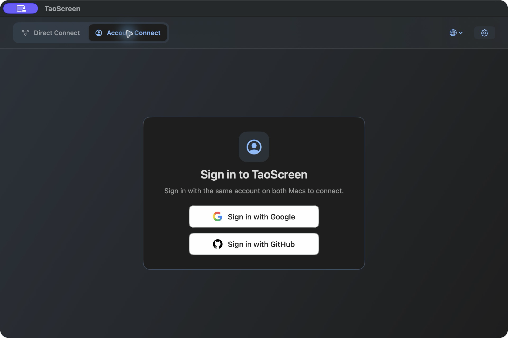

# TaoScreen User Guide

English · [简体中文](user-guide.md) · [Project README](../README.en.md) · [Self-hosting Guide](deployment.en.md)

- [Install and grant permissions](#install-and-grant-permissions)
- [Direct Connect](#direct-connect)
- [Account Connect](#account-connect)
- [Remote session controls](#remote-session-controls)
- [Troubleshooting](#troubleshooting)

## Install and grant permissions

TaoScreen supports macOS 14 or later on Apple silicon and Intel. Open the [universal DMG](https://taoscreen.xujiangtao.com/download?lang=en) and drag the app to **Applications**, or [build from source](../macos/README.en.md).

Use the globe button in the upper-right corner for **System Default**, **简体中文**, or **English**. TaoScreen follows the first supported language in macOS preferences by default. Changing the language takes effect after restarting the app and ends active connections.

On the Mac that will share its screen, open **Access Permissions**. In Direct Connect the button may instead say **Permissions Ready** if permissions are already granted.

| Permission | When it is needed |
| --- | --- |
| Screen & System Audio Recording | When the Mac shares its display or system audio |
| Accessibility | When the Mac accepts keyboard and mouse control. A viewer also needs it to forward system shortcuts using the remote shortcut mode. |
| Local Network | For Bonjour discovery of nearby devices on the LAN |

Open the relevant pane under **System Settings → Privacy & Security**, enable TaoScreen, and relaunch if macOS requests it. If you installed multiple builds, check that you granted access to the app you are running. Closing the main window leaves the app accessible through its menu bar icon.

## Direct Connect

Direct Connect is the default tab. It works between Macs on the same LAN or private Tailscale network without a TaoScreen account or signaling server.

### Temporary connections

1. On the host Mac, turn on **Allow Temporary Connections**. TaoScreen shows a temporary password and available LAN and Tailscale addresses.
2. On the other Mac, select an available device under **Tailscale Macs** or **Nearby LAN Devices**, or enter the host's Tailscale IP, MagicDNS hostname, or LAN address manually.
3. Enter the six-character temporary password and click **Connect**. The host must approve the request and choose what to share. The temporary listener uses TCP `45871`.
4. The host can copy its address and password. Advanced users can still use a compatible `TS1-` connection code.

For Tailscale connections, connect both Macs to a tailnet that permits communication between them. Bonjour discovery applies to the LAN. If Tailscale detection is unavailable, enter a known address manually.

### Tailscale unattended access

On the host Mac, use the **Tailscale Unattended Access** card. Both options require the Tailscale network.

- **Fixed password.** Set a password of at least eight characters, choose the default display and access permissions, and turn on **Allow with Fixed Password**. Use the host's Tailscale address and that password. The host listens on TCP `45873`.
- **Trusted device.** Approve a request and pair the device, then authorize it for unattended access under **Trusted Devices**. The host listens on TCP `45872`. You can revoke individual devices from the list.

Unattended direct sessions support screen sharing and any authorized keyboard, mouse, or system audio access. Confirmed direct sessions also support clipboard sync and file transfer. A sleeping or signed-out Mac cannot accept an unattended connection. A locked Mac can still accept authorized connections while its user session and network remain active.

## Account Connect

1. Open **Account Connect**. The official download uses TaoScreen's official service by default. Click **Sign in with Google** or **Sign in with GitHub** and complete authorization in the browser.
2. To use a self-hosted instance, sign out, open the gear menu, choose **Custom Server**, enter the instance's HTTPS root URL, and save. Use `http://127.0.0.1:28080` only for development on the same Mac as the server.
3. TaoScreen checks which sign-in methods the server enables. An enabled Google or GitHub button appears on the main sign-in page. When email/password access is enabled, select **Sign in with Email and Password** in the gear menu.
4. Use the same TaoScreen account on the same server on both Macs. Turn on **Enable Remote Desktop** on both. Under **Devices on this Account**, click **Connect** next to the host.

If the email address already belongs to a TaoScreen account, sign in with the original method, then use the account menu to link Google or GitHub. A matching email address does not merge accounts.

The host can approve requests individually or use **Unattended Access** to set a default display and authorize keyboard, mouse, file, clipboard, or audio access for devices on the same account. The setting applies to the current account and Mac.

For multiple sessions, switch tabs in the remote window. Closing the viewer window pauses rendering. Click **Open Window** to resume viewing, or **Disconnect** to end a session.

## Remote session controls

### Display, input, and audio

Use the session settings to switch among the five quality presets without reconnecting:

| Preset | Maximum resolution | Maximum frame rate |
| --- | --- | --- |
| Economy | 1280 × 720 | 15 fps |
| Standard | 1920 × 1080 | 30 fps |
| Smooth | 1920 × 1080 | 60 fps |
| High | 2560 × 1440 | 30 fps |
| Ultra | 3840 × 2160 | 30 fps |

The actual resolution and frame rate depend on the display and the connection. On the host, you can share a physical display or create a 1080p, 1440p, or 4K HiDPI virtual extended display. Switch to a physical display if macOS cannot create the virtual display.

The viewer can choose where shortcuts are handled, use local or remote input methods, and change the cursor mode. The connection indicator shows the route, actual endpoint addresses, and round-trip latency. It reflects the connection rather than Wi-Fi strength.

### Files and clipboard

If the session permits file transfer, use **Send Files…** to send files or folders. The receiving Mac normally saves them under `~/Downloads/TaoScreen`. In-window drag and drop can deliver a file to a target application. Approved staged drops are retained for up to seven days. Check the target application if it does not confirm delivery.

Clipboard sync is available in authorized sessions. A file copied in Finder can be sent over the session rather than pasted as a text path. Clipboard and file transfer are restricted in unattended Direct Connect sessions.

### Privacy Screen and lock on disconnect

Open **Privacy Screen** in the host settings to configure a preset or a custom image. The screen covers the physical display while an authorized remote session continues. On the host, press **Control–Option–Shift–Escape** to remove the privacy screen. Coverage can pause during an operating system lock screen.

In account mode, an authorized viewer can use the **Security** settings to save the remote login password in the local macOS Keychain, unlock with Touch ID when supported, or ask the host to lock after disconnecting. These features require authorization and system permissions. The saved password is stored on the controlling Mac.

### Standalone TCP and UDP forwarding

In Account Connect, open **Port Forwarding** and choose a device. The peer must enable its port service and authorize access. Add a rule with a name, listening port, destination host, and destination port. Choose TCP or UDP and the forwarding direction in the advanced settings when needed.

The listener binds to local loopback by default. Share it on the LAN only when other machines need access. A remote desktop session is optional. A conflict on the designated port leaves the rule stopped so you can choose another port.

## Troubleshooting

- **The host does not appear.** Confirm the account and server match in account mode. In Direct Connect, check the LAN or Tailscale path. Verify the macOS firewall and Tailscale ACLs allow the expected TCP listener and WebRTC traffic.
- **Permissions are enabled but the app still reports a problem.** Confirm the permission applies to the copy in use. Restart from the app's permissions panel and try again.
- **An unattended Mac stopped responding.** Locking the screen can preserve access while the user remains signed in. Sleep, logout, fast user switching, or a reboot can stop sharing until a session is available again.
- **Two networks cannot establish a connection.** Verify both endpoints are online. For self-hosted account connections across restrictive NAT, [configure a TURN relay](deployment.en.md#turn-relay).
- **Third-party sign-in is missing.** In **Custom Server**, check that the instance is reachable and that the administrator has enabled the provider. The client displays providers advertised by that server.
