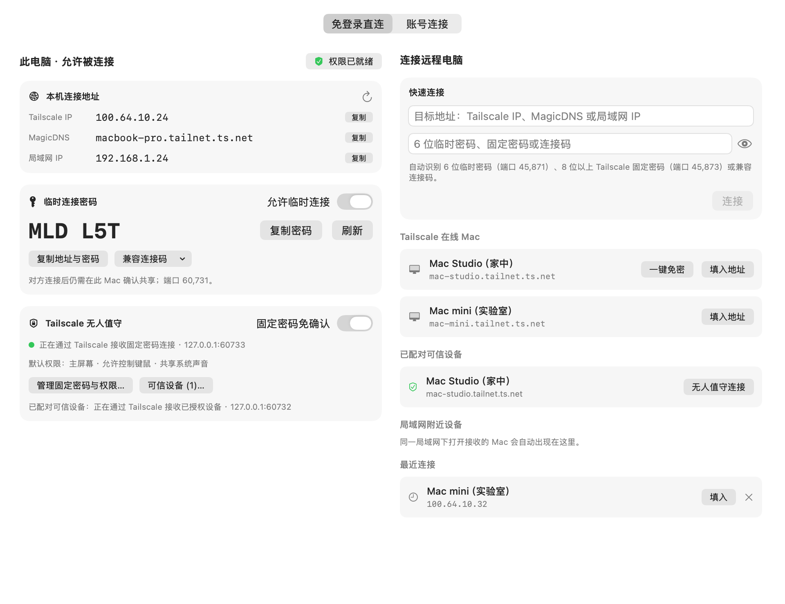
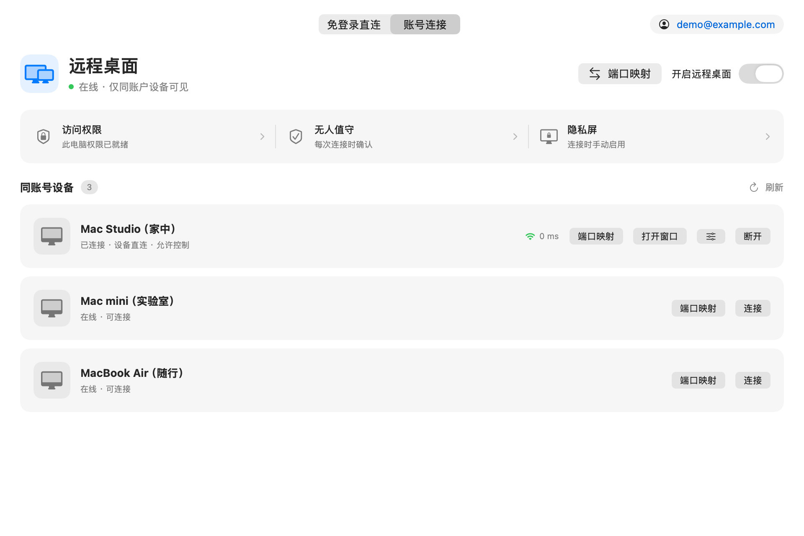
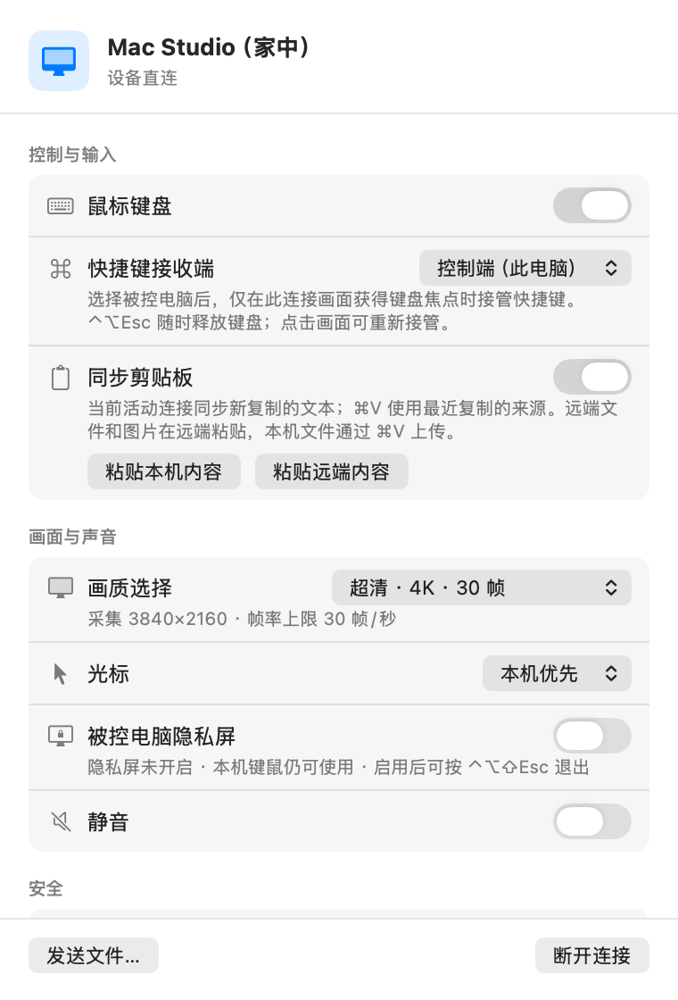
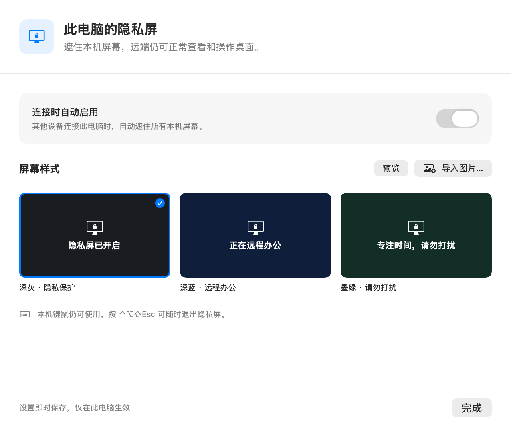
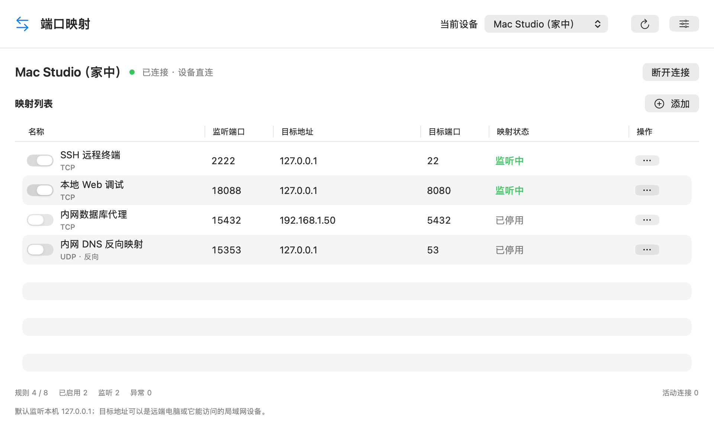
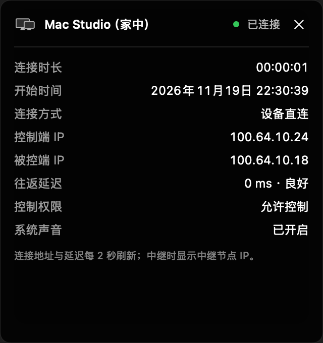

# TaoScreen 使用指南

[返回项目首页](../README.md) · [自托管部署指南](deployment.md) · [macOS 客户端开发说明](../macos/README.md) · [服务端说明](../server/README.md)

TaoScreen（涛子远程桌面）面向 **macOS 14 及以上**系统（支持 Apple Silicon 与 Intel 芯片），支持两种互补的连接方式：

1. **免登录直连（仅使用客户端）**：配合局域网或 [Tailscale](https://tailscale.com/) 直接建立点对点连接，**无需部署信令服务器、无需注册账号**，支持 6 位临时密码逐次确认，以及 Tailscale 固定密码 / 可信设备无人值守。
2. **账号连接（自托管信令服务端）**：两台或多台 Mac 登录同一自托管 [TaoScreen Server](../server/README.md) 账号，通过同账号设备列表直接发起连接，支持多窗口/多标签同时控制、独立双向 TCP/UDP 端口映射、钥匙串保存远程登录密码、断连自动锁屏及可选 TURN 中继。

---

## 目录

- [1. 安装与首次权限配置](#1-安装与首次权限配置)
- [2. 使用方式一：仅客户端免登录直连（局域网 / Tailscale）](#2-使用方式一只客户端免登录直连局域网--tailscale)
  - [2.1 Tailscale 环境准备](#21-tailscale-环境准备)
  - [2.2 临时密码直连（逐次确认，局域网与 Tailscale 通用）](#22-临时密码直连逐次确认局域网与-tailscale-通用)
  - [2.3 Tailscale 固定密码无人值守（免确认、支持锁屏直连）](#23-tailscale-固定密码无人值守免确认支持锁屏直连)
  - [2.4 Tailscale 可信设备配对免密](#24-tailscale-可信设备配对免密)
  - [2.5 免登录直连与账号模式能力差异](#25-免登录直连与账号模式能力差异)
- [3. 使用方式二：自托管信令服务器 + 同账号设备控制](#3-使用方式二自托管信令服务器--同账号设备控制)
  - [3.1 登录与绑定账号](#31-登录与绑定账号)
  - [3.2 同账号设备列表与多标签控制](#32-同账号设备列表与多标签控制)
  - [3.3 同账号无人值守](#33-同账号无人值守)
- [4. 远程控制与进阶功能](#4-远程控制与进阶功能)
  - [4.1 五档画质实时切换](#41-五档画质实时切换)
  - [4.2 虚拟扩展屏（1080p / 1440p / 4K HiDPI）](#42-虚拟扩展屏1080p--1440p--4k-hidpi)
  - [4.3 输入法、语音听写与 macOS 快捷键](#43-输入法语音听写与-macos-快捷键)
  - [4.4 剪贴板同步与文件传输](#44-剪贴板同步与文件传输)
  - [4.5 隐私屏](#45-隐私屏)
  - [4.6 本机钥匙串保存远程密码与断连锁屏](#46-本机钥匙串保存远程密码与断连锁屏)
  - [4.7 独立双向 TCP / UDP 端口映射](#47-独立双向-tcp--udp-端口映射)
  - [4.8 链路状态浮窗与防休眠保活](#48-链路状态浮窗与防休眠保活)
- [5. 常见问题排查（FAQ）](#5-常见问题排查faq)

---

## 1. 安装与首次权限配置

### 系统要求

- **操作系统**：macOS 14.0（Sonoma）及以上
- **芯片架构**：Apple Silicon（M 系列）与 Intel 均可
- **安装方式**：打开 `.dmg` 安装包将 `TaoScreen.app` 拖入「应用程序」，或按照 [macOS 构建说明](../macos/README.md) 从源码构建

### 被控端权限清单

如果这台 Mac 只作为**控制端**去连接其他电脑，通常不需要授予录屏或辅助功能权限（仅当在连接窗口开启「快捷键接收端 → 被控电脑」使用系统快捷键接管时，控制端也需要辅助功能权限）。

如果这台 Mac 需要作为**被控端**共享屏幕或被控制，需按需授予以下权限：

| 权限名称 | 系统设置路径 | 用途与说明 |
| --- | --- | --- |
| **录屏与系统录音（屏幕录制）** | `系统设置 → 隐私与安全性 → 录屏与系统录音` | **必须授予**。用于采集桌面画面与系统声音。 |
| **辅助功能** | `系统设置 → 隐私与安全性 → 辅助功能` | **允许键鼠控制时必须授予**；仅观看模式不要求此权限。 |
| **本地网络** | `系统设置 → 隐私与安全性 → 本地网络` | 局域网免登录直连时通过 Bonjour 自动发现附近设备。 |

### 权限检查与生效说明

- 在主界面点击 **「权限检查…」**（账号模式顶部为 **「访问权限」**，免登录直连右上角为 **「权限已就绪 / 权限检查」**）即可实时查看两项核心权限的当前状态，并一键打开对应的系统设置页面。
- 首次在系统设置中勾选「屏幕录制」后，macOS 通常要求重新启动应用才能生效。如果系统列表已勾选但应用检查仍提示未授权：
  1. 先确认系统列表里勾选的正是当前运行的 `TaoScreen.app`（尤其是同时存在源码开发版与正式安装版时）。
  2. 点击权限检查页的 **「重启 TaoScreen…」**，确认后会安全关闭连接并重启当前应用实例。
- 应用启动后远程桌面开关默认关闭，关闭主窗口后会在菜单栏保留常驻图标，可通过菜单栏随时停止共享或退出。

---

## 2. 使用方式一：仅客户端免登录直连（局域网 / Tailscale）

如果你的设备处于同一局域网，或通过 **Tailscale** 组成了虚拟内网，可以直接打开 TaoScreen 顶部的 **「免登录直连」** 标签页完成连接——**全程不需要部署或登录 TaoScreen Server，不经过任何第三方中转服务器**。

### 2.1 Tailscale 环境准备

1. 在控制端与被控端两台 Mac 上分别安装并登录同一 Tailnet（或互相可达的 Tailscale 节点）下的 [Tailscale](https://tailscale.com/) 客户端。
2. TaoScreen 会自动检测本机连接地址并展示在左侧 **「本机连接地址」** 卡片中（包含 `Tailscale IP`、`MagicDNS` 与 `局域网 IP`）：
   - **独立官网版 / Homebrew 版 Tailscale**：TaoScreen 通过本机 Tailscale CLI（`/usr/local/bin/tailscale`、`/opt/homebrew/bin/tailscale` 或 `/Applications/Tailscale.app/Contents/MacOS/Tailscale`）自动读取本机地址，并在右侧 **「Tailscale 在线 Mac」** 中列出在线的 macOS 节点，可直接点击 **「填入地址」** 或 **「一键免密」**。
   - **Mac App Store 版 Tailscale**：由于沙盒版可能不提供 CLI 工具，TaoScreen 会自动回落扫描系统 `utun` 隧道接口获取 Tailscale 地址（此时仅需手动输入对方 Tailscale IP 或 MagicDNS 即可连接）。

### 2.2 临时密码直连（逐次确认，局域网与 Tailscale 通用）

适合临时协助、偶尔互控或同局域网快速分享屏幕。

1. **在被控 Mac 上准备接收**：
   - 切换到 **「免登录直连」**，开启 **「允许临时连接」**（默认开启）。
   - 界面显示 6 位临时连接密码（例如 `MLD L5T`），默认监听 TCP **`45871`** 端口。可点击 **「刷新」** 重新生成密码，或点击 **「复制密码」** / **「复制地址与密码」** 发送给控制端；「兼容连接码」菜单中也提供 `taoscreen-direct://` 连接链接与 `TS1-` 完整连接码。
2. **在控制 Mac 上发起连接**：
   - **Tailscale / 指定地址**：在右侧 **「快速连接」** 的目标地址栏填入被控 Mac 的 `Tailscale IP`（`100.x.y.z`）、`MagicDNS`（如 `mac-studio.tailnet.ts.net`）或局域网 IP，在密码栏输入 6 位临时密码（支持自动识别大小写及空格），点击 **「连接」**。也可直接点击「Tailscale 在线 Mac」或「最近连接」旁的 **「填入地址 / 填入」** 快速填充。
   - **同一局域网自动发现**：同一局域网下打开接收的 Mac 会自动出现在 **「局域网附近设备」**（Bonjour），点击 **「连接…」** 并输入 6 位临时密码即可。
3. **在被控 Mac 上逐次确认**：
   - 被控 Mac 收到请求后弹出确认窗口，可按本次需要选择：
     - **共享屏幕**：主屏幕、指定物理显示器，或临时创建的虚拟扩展屏；
     - **控制与输入**：是否允许鼠标键盘控制、粘贴文本和接收文件；
     - **系统声音**：是否共享本机系统声音；
     - **记为可信设备**：如后续需要通过 Tailscale 免密无人值守连接，可勾选此项。
   - 点击 **「接受并共享」** 后即建立 WebRTC 加密会话。

> **安全机制说明**：临时密码握手使用 **通道绑定 PAKE（Curve25519 Elligator2）** 双向验证密码并将身份绑定到当前 TLS 证书指纹，密码本身不会在网络中明文传输；连续输错 5 次将锁定 60 秒。接收端默认仅接受来自局域网私有网段、回环地址和 Tailnet（`100.64.0.0/10` / `fd7a:115c:a1e0::/48`）的连接请求。

### 2.3 Tailscale 固定密码无人值守（免确认、支持锁屏直连）

适合个人常用多台 Mac 之间通过 Tailscale 随时远程连接，无需被控端人工点按确认，且被控 Mac 锁屏后仍可直接连入并输入系统登录密码解锁。

1. **在被控 Mac 上配置固定密码**：
   - 在 **「免登录直连 → Tailscale 无人值守」** 卡片点击 **「设置固定密码…」**（或 **「管理固定密码与权限…」**）。
   - 输入至少 **8 个字符**（最长 128 字节）的强密码，或点击 **「随机生成强密码」** 后复制保存。密码仅以加盐 **PBKDF2-HMAC-SHA256**（100,000 轮）校验摘要保存在本机 macOS 钥匙串中，不保存明文。
   - 按需配置默认权限：共享屏幕（主屏幕或指定分辨率虚拟屏）、允许控制鼠标和键盘、共享系统声音，以及是否开启 **「登录 macOS 后启动 TaoScreen」**。
   - 返回主界面后，打开 **「固定密码免确认」** 开关，状态灯变为绿色即表示已在 Tailscale 接口的 TCP **`45873`** 端口就绪。
2. **在控制 Mac 上发起无人值守连接**：
   - 在 **「快速连接」** 填入被控 Mac 的 `Tailscale IP` 或 `MagicDNS`，密码框输入设置的固定密码，点击 **「连接」**。
   - 客户端会自动识别为 8 位以上固定密码，使用 `45873` 端口完成通道绑定 PAKE 验证后直接开启共享（**该端口与方式仅限 Tailscale 内网来源，拒绝公网或普通局域网访问**）。

### 2.4 Tailscale 可信设备配对免密

如果不想每次输入密码，可以通过设备密钥对进行点对点授权：

1. 先用 **临时密码** 从控制端连向被控 Mac，被控 Mac 在确认窗口中勾选 **「记为可信设备」** 并接受连接，双方的 P-256 设备公钥会存入各自本机钥匙串。
2. 在被控 Mac 的「Tailscale 无人值守」卡片点击 **「可信设备…」**，开启总开关 **「允许已配对设备通过 Tailscale 无人值守」**，并为目标设备开启 **「允许此设备无人值守连接到本机」** 及授权屏幕/键鼠/声音权限（服务绑定 Tailscale 地址与 TCP **`45872`** 端口）。
3. 在控制 Mac 的 **「Tailscale 在线 Mac」** 或 **「已配对可信设备」** 中，直接点击 **「一键免密」** 或 **「无人值守连接」** 即可免密码连入。
4. 两端每次连接均通过双向 TLS 验证设备公钥。在被控 Mac 取消该设备的授权或关闭开关，正在进行的会话会立即中断。

### 2.5 免登录直连与账号模式能力差异

- **逐次确认直连（临时密码 / 连接码）**：支持屏幕、键鼠、声音、虚拟屏、文件拖放/发送及剪贴板同步。
- **Tailscale 无人值守直连（固定密码 / 可信设备）**：支持屏幕（含虚拟屏）、键鼠与系统声音；处于限制会话保护，**不启用**自动剪贴板同步与文件传输。
- **仅「账号连接」模式独有**：同账号在线设备发现、独立双向 TCP/UDP 端口映射、控制端钥匙串 Touch ID 一键解锁、断开连接自动锁屏、跨复杂 NAT 的可选 TURN 服务器中继。

---

## 3. 使用方式二：自托管信令服务器 + 同账号设备控制

当你的设备分布在不同网络（如公司/家庭/移动热点）、希望通过统一账号管理所有在线设备，或需要使用**独立端口映射**、**钥匙串一键解锁**、**断连自动锁屏**和 **TURN 中继**时，可搭建自己的 TaoScreen 信令服务器（部署步骤见 [自托管部署指南](deployment.md)），并通过客户端顶部的 **「账号连接」** 使用。

### 3.1 登录与绑定账号

1. 切换到 **「账号连接」** 标签页，在服务器地址栏填写自托管实例的 HTTPS 根地址（例如 `https://desktop.example.com`；本地开发调试可使用 `http://127.0.0.1:28080`）。
2. 客户端会自动向服务端查询启用的登录方式，按需展示：
   - **邮箱和密码登录**：使用管理员开通或本地注册的账号直接登录；
   - **Google / GitHub 登录**：通过系统安全认证浏览器会话（`ASWebAuthenticationSession`）与 PKCE 授权跳回应用完成登录。
3. 登录后可点击右上角账号按钮查看当前服务器与已绑定的登录方式，并可点击 **「绑定 Google / GitHub」** 将多个登录方式关联到同一个 TaoScreen 账号 UUID，确保名下设备与授权一致。

### 3.2 同账号设备列表与多标签控制

- 登录同一账号且开启右上角 **「开启远程桌面」** 开关的 Mac 会自动出现在 **「同账号设备」** 列表中，并随在线状态实时更新。
- 点击任意在线设备的 **「连接」** 即可发起会话；被控端在弹出的确认框中决定共享屏幕、是否允许键鼠与文件、是否共享系统声音。
- **多设备并行控制**：所有观看会话共用一个远程桌面窗口，顶部以标签页切换不同被控 Mac；点击各标签上的信号/延迟图标可快速查看或切换当前连接。
- **关闭窗口保活**：关闭远程桌面观看窗口会释放焦点并停止画面渲染以节省资源，但**不会断开会话**，在主窗口点击 **「打开窗口」** 可随时恢复画面；点击 **「断开」** 或 **「停止共享」** 才会正式结束会话。

### 3.3 同账号无人值守

在账号模式主界面顶部的 **「无人值守」** 快捷入口中，可设置：

- **允许同账号设备免确认连接此电脑**（按当前服务器和账号隔离保存在本机）；
- 默认共享屏幕（连接时的主屏幕、特定物理显示器，或 `1080p / 1440p / 4K HiDPI` 虚拟扩展屏）；
- 是否默认允许鼠标键盘控制、粘贴文本和接收文件；
- 是否默认共享系统声音。

> 注意：被控 Mac 休眠、退出登录或切换 macOS 用户会话会停止共享；保持登录后锁屏时，已开启同账号无人值守的 Mac 仍可被同账号设备连入，并支持远程解锁。

---

## 4. 远程控制与进阶功能

### 4.1 五档画质实时切换

在远程控制窗口右上角点击设置图标（或在设备卡片点击连接设置按钮），在 **「画面与声音 → 画质选择」** 中无需重新连接即可动态切换画质与帧率上限：

| 画质档位 | 16:9 分辨率上限 | 帧率上限 | 初始 / 最大视频码率 | 适用场景 |
| --- | --- | --- | --- | --- |
| **节省流量** | `1280 × 720` | 15 帧/秒 | 2 / 4 Mbps | 低带宽移动网络、纯文字终端巡检 |
| **标准** | `1920 × 1080` | 30 帧/秒 | 4 / 8 Mbps | 常规远程办公与文档处理 |
| **流畅优先** | `1920 × 1080` | 60 帧/秒 | 8 / 16 Mbps | 网络受限时**优先保帧率**，滚动与拖拽更跟手 |
| **高清** | `2560 × 1440` | 30 帧/秒 | 6 / 16 Mbps | 2K 显示器精细代码阅读与多窗口排布 |
| **超清（默认）** | `3840 × 2160` | 30 帧/秒 | 8 / 24 Mbps | 4K Retina 桌面，纤毫毕现 |

- 仅按屏幕实际像素与比例等比缩小，不会对低分辨率物理屏幕强行插值放大。
- 除「流畅优先」外，其余档位在带宽波动时优先保持分辨率清晰度。
- 成功确认后的画质选择会在控制端按服务器、账号和被控设备独立记忆，下次重连自动应用。

  

### 4.2 虚拟扩展屏（1080p / 1440p / 4K HiDPI）

被控 Mac 在逐次确认窗口的「共享屏幕」下拉菜单，或「无人值守 / 可信设备」设置中，可选择创建一块独立的 60 Hz macOS 虚拟扩展显示器，而不干扰被控端现有的实体屏幕布局（或方便无外接显示器的 Mac mini / Mac Studio 调节分辨率）：

- **`1920 × 1080`**（标准 FHD 扩展屏）
- **`2560 × 1440`**（2K QHD 扩展屏）
- **`3840 × 2160（HiDPI）`**（对应 `1920 × 1080` 逻辑工作区、4K 像素精细渲染）

创建后可在被控 Mac 的系统「显示器」设置中调整排列，把需要远程处理的窗口拖到该扩展屏中；会话结束或退出 TaoScreen 时系统会自动移除该虚拟屏。

> 注：虚拟显示器依赖 macOS 非公开显示接口；在系统锁屏或无实体显示器环境下的可用性取决于被控机的 macOS 版本与显卡显示环境。

### 4.3 输入法、语音听写与 macOS 快捷键

- **远端输入法 vs 本机输入法**：在远程窗口标题栏可一键切换输入方式：
  - **远端输入法**：直接把按键事件发送到被控 Mac，由被控 Mac 上的输入法处理；
  - **本机输入法**（带麦克风图标）：使用控制端这台 Mac 的输入法打字或 macOS 语音听写，预编辑文字会以半透明字幕实时浮现在画面底部，确认上屏后整段提交到远端输入框（不修改控制端剪贴板）。
- **快捷键接收端**：在连接设置中可选择快捷键由 **「控制端（此电脑）」** 处理还是交给 **「被控电脑」** 接管（如 `⌘C`、`⌘Tab`、`⌘Space` 等系统级快捷键）；选择被控电脑时，**随时按 `⌃⌥Esc`** 或点击顶部导航栏均可立即释放远端键盘接管。
- **顶部 Mac 快捷操作按钮**：标题栏内置常用 macOS 操作按钮与菜单，直接向被控电脑发送标准系统快捷键（即使当前快捷键接收端设为本机也有效）：
  - **所有窗口**：`⌃↑`（调度中心）
  - **显示 Dock**：`⌃F3`
  - **当前应用窗口**：`⌃↓`
  - **显示桌面**：`F11`
  - **切换全屏**：`⌃⌘F`
  - **退出当前界面**：`Esc`
- **光标模式**：支持在「本机优先」与「远端原样」之间切换显示风格。

### 4.4 剪贴板同步与文件传输

- **剪贴板双向同步**（非限制性会话可用）：在连接设置中开启 **「同步剪贴板」** 后，当前活动连接会自动同步控制端与被控端新复制的文本；也可直接点击 **「粘贴本机内容」** 或 **「粘贴远端内容」**；在控制端选中本地文件后按 `⌘V` 还可直接触发上传粘贴。
- **拖拽投放与文件发送**：
  - 将本地文件直接拖拽到远程窗口内的目标区域（如 Finder 窗口或桌面），被控端接收后会弹出文件返回面板或自动投递到拖放位置（远端暂存文件保留 7 天，支持一键复制远端路径）；
  - 也可通过连接设置底部的 **「发送文件…」** 选择文件或整个目录发送，接收内容默认保存至被控 Mac 的 **`下载/TaoScreen`** 目录。
  - 所有文件传输均运行在独立的可靠 WebRTC 数据通道上，先写入独占暂存目录并进行 **SHA-256 完整性校验**，校验通过后才会移入目标位置。

### 4.5 隐私屏

当你需要操作办公电脑但不想让旁边路过的人看到被控 Mac 实体屏幕内容时，可启用 **隐私屏**：

- 在账号模式主界面顶部 **「隐私屏」** 中可设置 **「连接时自动启用」**，或在远程会话中通过控制端「连接设置 → 被控电脑隐私屏」实时开关；
- 提供 3 种内置样式（**深灰 · 隐私保护**、**深蓝 · 远程办公**、**墨绿 · 请勿打扰**），并支持导入最多 **20 张**自定义图片（PNG/JPEG/HEIC/TIFF/WebP）；
- 隐私屏窗口通过 ScreenCaptureKit 采集排除列表对控制端透明，**遮住被控端所有实体显示器，而控制端仍可正常查看和操作真实桌面**；
- 在被控 Mac 本地按下快捷键 **`⌃⌥⇧Esc`** 可随时紧急退出隐私屏。

### 4.6 本机钥匙串保存远程密码与断连锁屏

在 **账号连接** 模式下的连接设置 **「安全 → 登录密码与断连锁屏」** 中，提供两项实用安全能力（均不向服务器上传密码）：

1. **保存远程密码与验证后解锁**：
   - 将被控 Mac 的系统登录密码按「服务地址 + 账号 + 设备 ID」隔离保存在控制端本机钥匙串（关闭 iCloud 同步；带 Secure Enclave 的 Mac 由硬件私钥保护）。
   - 当被控 Mac 锁屏时，控制端画面顶部会显示锁定提示，点击远端密码框后点击 **「验证后解锁」**，通过控制端 Mac 的 **触控 ID** 或本机系统密码验证后，经当前加密控制通道安全输入密码解锁。
2. **断开连接后锁定被控电脑**：
   - 开启后（需被控端确认并具备辅助功能权限），当控制端主动断开、退出应用或网络异常重连超时导致会话彻底结束时，被控端会自动执行系统标准 **`⌃⌘Q` 锁屏快捷键**。短暂网络闪断重连和仅关闭观看窗口不会触发误锁屏。

### 4.7 独立双向 TCP / UDP 端口映射

在 **账号连接** 模式下，TaoScreen 提供独立于远程桌面的 **双向 TCP / UDP 端口映射** 功能（无需先建立画面连接即可使用）：

- **入口**：在设备卡片上点击 **「端口映射」**，或通过菜单栏 / 主界面顶部入口打开管理窗口并切换设备。
- **授权隔离**：对方需开启端口服务，并在收到映射请求时逐次允许（或开启当前账号的自动允许）。端口服务独立于远程桌面授权，**不申请**屏幕录制或辅助功能权限。
- **规则配置**：
  - 基础四字段：**名称**、**本地端口 / 监听端口**、**目标地址**（可填对端的 `127.0.0.1`、IPv4/IPv6、ASCII 主机名，或对端能访问的局域网内网设备地址）、**目标端口**；
  - 展开 **「高级设置」** 可选：**TCP / UDP** 协议、**正向映射（本机监听 → 远端目标）** 或 **反向映射（远端监听 → 本机目标）**、监听范围（仅本机 `127.0.0.1` 或共享给局域网 `0.0.0.0`）。
- **状态与生命周期**：支持单条启停、编辑、删除前确认、**创建副本**（保留目标并清空端口防冲突）、离线提前编辑并在上线后自动恢复启用；关闭端口映射窗口前如有本机发起的连接会弹窗确认是否断开。
- **独立安全通道**：建立专用的 `desktop-ports.v1` WebRTC 可靠数据通道转发字节流与 UDP 数据报（保留数据报边界），不经过 HTTP 信令，关闭远程桌面也不会中断正在运行的端口映射。

### 4.8 链路状态浮窗与防休眠保活

- **连接信息与链路质量浮窗**：将鼠标悬停在远程窗口标签页上的信号与延迟图标上（或点击固定），可实时查看连接时长、开始时间、连接方式（`设备直连` / `服务器中继` / `免登录直连` / `Tailscale 无人值守`）、**控制端 IP** 与 **被控端 IP**（支持 IPv4/IPv6，中继通道明确标注 `（中继）`）、每 2 秒刷新的 RTT 延迟以及当前控制/声音权限状态。

  

- **保持 Mac 唤醒**：打开应用「设置（`⌘,`）→ 远程连接与睡眠」，默认开启 **「远程服务开启期间保持 Mac 唤醒」**。开启桌面或端口服务后，即使暂无活动连接，macOS 也会阻止自动进入系统睡眠（仍允许息屏与锁屏以兼顾隐私与功耗；手动合盖或系统睡眠仍会中断连接）。

---

## 5. 常见问题排查（FAQ）

**Q1：系统设置里明明已经勾选了「屏幕录制」或「辅助功能」，为什么应用还提示未授权？**  
A：常见于以下三种情况：
1. 本机同时保留了旧版本、开发构建版或安装包里的 `TaoScreen.app`，系统权限勾选的是另一个路径或签名身份的应用副本。建议清理多余副本，在系统权限列表中删除旧记录后重新添加 `/Applications/TaoScreen.app`。
2. 首次开启屏幕录制权限后未重启应用。请在权限检查弹窗中点击 **「重启 TaoScreen…」**。
3. 通过命令行 `swift run` 运行调试时，权限绑在终端宿主（如 Terminal / iTerm）上；日常使用和权限验证请运行打包好的 `.app` 产物（如 `macos/dist/TaoScreen.app`）。

**Q2：通过 Tailscale 免登录直连时，提示连接超时或无法建立画面怎么办？**  
A：请按以下步骤排查：
1. 确认两端均已登录且连通 Tailscale（可在终端执行 `tailscale ping <对方节点>` 验证双向可达）；若使用 Tailscale ACL，确保策略放行了对应设备的 TCP **`45871`**（临时密码）、**`45872`**（可信设备）、**`45873`**（固定密码）以及 WebRTC 点对点 UDP 流量。
2. 检查被控 Mac 的「系统设置 → 网络 → 防火墙」是否拦截了 `TaoScreen.app` 的入站连接。
3. 使用固定密码或可信设备无人值守时，确认被控端 Tailscale 卡片状态点为绿色在线，且接收端口监听的是 Tailscale 隧道接口地址。

**Q3：Mac 锁屏、黑屏熄屏、合盖休眠或重启后还能连接吗？**  
A：
- **已登录且仅锁屏 / 熄屏**：只要被控 Mac 开启了 **「远程服务开启期间保持 Mac 唤醒」** 且尚未进入系统睡眠，**Tailscale 无人值守**（固定密码 / 可信设备）和**同账号无人值守**均可直接连接，连入后可在锁屏界面输入密码或使用触控 ID 一键解锁。
- **未登录用户会话 / 重启后停留在 FileVault 或开机登录界面 / 退出登录 / 盖上屏幕深度休眠**：此时 macOS 用户会话和普通用户态网络/图形采集服务尚未启动或已挂起，需等到开机登录该 macOS 用户会话并启动 TaoScreen（可在无人值守设置中开启「登录 macOS 后启动 TaoScreen」）后方可恢复连接。

**Q4：开启「虚拟屏」共享失败或提示变成镜像怎么处理？**  
A：虚拟扩展屏依赖 macOS 非公开显示接口。若在被控 Mac 系统「显示器」设置中勾选了镜像模式，或当前无物理显示器环境下系统不允许创建该分辨率模式，共享会自动终止并提示原因。可在被控端切换为其它预设分辨率（如 `1920 × 1080`），或改回共享「主屏幕」后重连。
